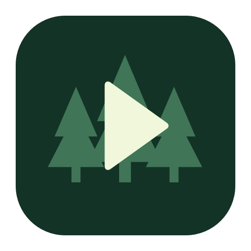

# Mori Player

English | [简体中文](README.md)

A native macOS local media player built with Swift, SwiftUI, and AVFoundation. Mori means “forest”; its minimal green icon combines a small forest with a clear play symbol.



## Features

- Open local video or audio files and start playback automatically. Play, pause, stop, and seek.
- Bottom controls, from left to right: back 5 seconds, play/pause, forward 5 seconds, stop, elapsed / total time, seek slider, remaining time, volume slider, and fullscreen. No playlist button.
- Drag the seek slider to navigate. Play again after reaching the end to restart from the beginning.
- Playback speed from 0.25× to 4× in 0.25× increments, with an on-screen indicator whenever the speed differs from 1×.
- Native fullscreen, keyboard and mouse controls, and a grouped reference panel in Settings.
- Sandboxed, read-only access to files selected through the system file picker.

## Keyboard and mouse controls

Playback shortcuts apply in the player window. Open **Mori Player → Settings…** (`⌘,`) for the full reference.

| Action | Keyboard | Mouse |
| --- | --- | --- |
| Open a file | `⌘O` | Welcome screen button or File menu |
| Play / pause | `Space` | Click the playback area or play/pause button |
| Back / forward 5 seconds | `←` / `→` | Corresponding control bar buttons |
| Stop and return to the beginning | — | Stop button |
| Toggle fullscreen | `⌃⌘F` | Double-click the playback area or click the fullscreen button |
| Exit fullscreen | `Esc` | Fullscreen button |
| Increase / decrease volume | `↑` / `↓`, 5% per press | Wheel up / down over the playback area, or drag the volume slider |
| Increase / decrease speed by 0.25× | `A` / `S` | — |
| Seek to a position | — | Drag the seek slider |

`⌘` means Command; `⌃` means Control. Single clicks in the playback area wait for the system double-click interval so that entering fullscreen does not accidentally pause playback.

## Run and build

The deployment target is macOS 14.0, using Swift 6. Validated with Xcode 26.6, Swift 6.3.3, and Apple Silicon. macOS 14 and Intel Macs have not been tested on hardware. No third-party dependencies are required.

Open `MoriPlayer.xcodeproj`, select the `MoriPlayer` scheme and `My Mac`, then press `⌘R`. Alternatively:

```sh
xcodebuild -project MoriPlayer.xcodeproj \
  -scheme MoriPlayer \
  -configuration Debug \
  -destination 'platform=macOS' \
  -derivedDataPath .build/DerivedData \
  build
```

The app is located at `.build/DerivedData/Build/Products/Debug/Mori Player.app`. Local development uses ad hoc signing. Configure a production bundle identifier, developer signing, and notarization before distribution.

## Validation

These integration checks generate a local audio fixture and exercise the real AVPlayer: loading, playback/pause, seeking, stop, volume/speed limits, end/replay, invalid media, and rapid file replacement.

```sh
mkdir -p .build
swiftc -swift-version 6 -parse-as-library \
  MoriPlayer/Features/Player/PlayerModel.swift Tests/PlayerSmokeTests.swift \
  -o .build/player-smoke-tests
.build/player-smoke-tests
```

## Layout

```text
MoriPlayer/
├── App/                   # Entry point, menus, and Settings scene
├── Features/
│   ├── Player/            # Playback state, video surface, controls, and input
│   └── Settings/          # Keyboard and mouse reference
└── Resources/             # App icons and accent color
Scripts/GenerateIcon.swift # Reproducible vector icon rendering with AppKit
Tests/PlayerSmokeTests.swift
```

Regenerate icons with `swift Scripts/GenerateIcon.swift`. Xcode automatically includes source files and resources under `MoriPlayer/`.

## Current scope

Playback depends on the native macOS decoders and each file’s container/codec combination; arbitrary MKV, AVI, and other files are not guaranteed to work. VLCKit, playlists, subtitle selection, network streaming, and playback history are not implemented. The current interface follows the written requirements and has not yet been compared with the reference screenshot.
